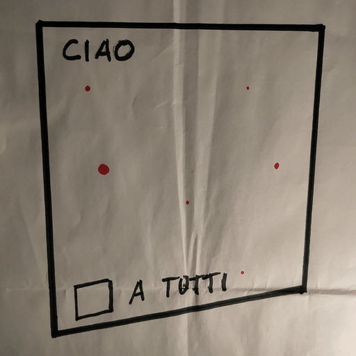
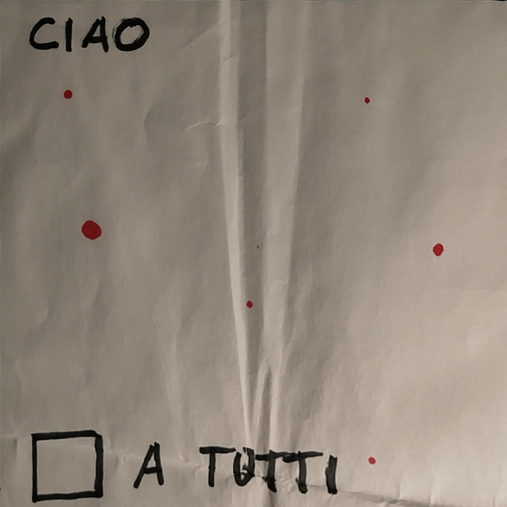

#  Depersp

Libreria PHP che raddrizza automaticamente la foto di un foglio con una
cornice scura, eliminando la prospettiva. È scritta in PHP puro con
l'estensione **Imagick**: nessuno script shell, nessun `exec()`.

 

## Requisiti

- PHP ≥ 8.1 con le estensioni `imagick` e `fileinfo`
- ImageMagick con i coder JPEG, PNG e WebP abilitati. Una `policy.xml`
  restrittiva va benissimo: MVG, SVG, XC, GRADIENT e simili non servono.

## Installazione

```bash
composer require crickyx/depersp
```

Finché il pacchetto non è su Packagist, si può installare direttamente dal
repository git:

```json
{
    "repositories": [{ "type": "vcs", "url": "https://github.com/<utente>/depersp" }],
    "require": { "crickyx/depersp": "^1.0" }
}
```

Senza Composer basta includere `src/autoload.php`.

## Uso rapido

```php
use Depersp\{Rectifier, DetectionException, InvalidImageException};

$rectifier = new Rectifier();

try {
    // Byte in ingresso, byte in uscita: niente viene scritto su disco.
    $result = $rectifier->rectifyBlob($bytes, 'jpg');

    header('Content-Type: ' . $result->mimeType);
    echo $result->data;
} catch (DetectionException $e) {
    // foto valida, ma senza una cornice riconoscibile
} catch (InvalidImageException $e) {
    // non è un JPEG/PNG/WebP, è corrotta o troppo grande
}
```

Per lavorare con i file:

```php
$result = $rectifier->rectifyFile('foto.jpg', 'foto-dritta.png');
```

Altri esempi pronti all'uso si trovano in [examples/](examples/).

## Privacy: nessuna immagine salvata

`rectifyBlob()` lavora interamente in memoria: la foto ricevuta e quella
prodotta non vengono mai scritte su disco dalla libreria. L'esempio
[examples/upload/upload.php](examples/upload/upload.php) ne approfitta:

1. legge il file temporaneo dell'upload e lo cancella subito (PHP lo
   cancellerebbe comunque a fine richiesta);
2. raddrizza l'immagine in memoria;
3. la rimanda al browser con `Cache-Control: no-store`.

Sul server non resta nulla. Dall'immagine prodotta vengono rimossi anche i
metadati EXIF, posizione GPS compresa.

Con foto enormi ImageMagick può appoggiarsi temporaneamente al disco (pixel
cache) e poi cancella da solo quei file. Si può impedirlo abbassando il limite
`disk` nella `policy.xml`, oppure puntando `MAGICK_TEMPORARY_PATH` su un
filesystem in RAM (`tmpfs`).

Se la vostra applicazione deve conservare le immagini per un po', usate
`rectifyFile()` e cancellatele con un cron, per esempio dopo 30 minuti:

```bash
find /percorso/immagini -type f -mmin +30 -delete
```

## API

### `Depersp\Rectifier`

| Metodo | Descrizione |
|---|---|
| `rectifyBlob(string $bytes, string $format = 'jpg'): Result` | elaborazione in memoria; `$format`: `jpg`, `png` o `webp` |
| `rectifyFile(string $in, string $out): Result` | da file a file; il formato si ricava dall'estensione di `$out`, la scrittura è atomica e l'input non viene modificato |
| `rectify(Imagick $img): array` | per chi lavora già con Imagick: restituisce `[Imagick $out, array $corners]` |
| `load(string $path)` / `loadBlob(string $bytes): Imagick` | solo validazione e decodifica |
| `static applyResourceLimits(int $memory, int $time)` | limiti prudenti per ImageMagick, da chiamare una volta nei worker web |

Opzioni del costruttore, tutte facoltative e passabili per nome:

| Opzione | Default | |
|---|---|---|
| `detector` | `new QuadDetector()` | rilevatore della cornice |
| `outputWidth`, `outputHeight` | `null` | dimensione fissa dell'uscita (vanno impostate entrambe) |
| `maxOutputSide` | `2048` | lato massimo quando la dimensione è automatica |
| `margin` | `0.01` | frazione rifilata su ogni lato per eliminare i residui della cornice |
| `quality` | `90` | qualità JPEG/WebP |
| `maxFileBytes` | 25 MB | dimensione massima dell'input |
| `maxPixels` | 50 MP | numero massimo di pixel, controllato prima della decodifica |
| `linearLight` | `false` | ricampionamento in luce lineare: un po' più morbido, circa 2× più lento |

### `Depersp\Result`

Proprietà in sola lettura:
- `width`, `height`: dimensioni dell'uscita;
- `mimeType`: tipo dell'immagine prodotta;
- `data`: i byte dell'immagine, valorizzato solo da `rectifyBlob()`;
- `outputPath`: il file scritto, valorizzato solo da `rectifyFile()`;
- `corners`: gli angoli trovati nella foto, in ordine alto‑sinistra, alto‑destra, basso‑destra, basso‑sinistra;
- `seconds`: il tempo impiegato.

`toArray()` restituisce gli stessi dati senza i byte dell'immagine.

### `Depersp\QuadDetector`

`new QuadDetector(workSize: 800, passes: [[0.6, 1], [0.7, 3], [0.85, 4]], minAreaRatio: 0.05, minFill: 0.85)`

`passes` è l'elenco dei tentativi `[inkRatio, closeRadius]`, provati in ordine
finché uno riesce. Le passate più tolleranti, usate solo se le precedenti
falliscono, servono per cornici sottili, sbiadite o con piccole interruzioni.

### Eccezioni

Tutte estendono `Depersp\DeperspException`:
- `InvalidImageException`: input non utilizzabile;
- `DetectionException`: cornice non trovata. Conviene suggerire all'utente di inquadrare tutti e quattro gli angoli.

## Riga di comando

```bash
vendor/bin/depersp foto.jpg                         # -> foto.jpg-dp.png
vendor/bin/depersp foto.jpg out.jpg --size=1024x1024 --json
```

Opzioni: `--size=WxH`, `--max-side=N`, `--margin=F`, `--quality=N`,
`--linear`, `--json`.

Codici di uscita: `0` ok, `1` errore, `2` cornice non trovata, `3` file non valido.

## Esempi

- [examples/basic.php](examples/basic.php): elaborazione in memoria, da file a file e lettura degli angoli.
- [examples/upload/](examples/upload/): pagina con form, utilizzabile anche da smartphone, e un endpoint che restituisce direttamente l'immagine raddrizzata senza salvare nulla.

```bash
php -S 127.0.0.1:8000 -t examples/upload    # poi aprite http://127.0.0.1:8000/
```

Risposte di `upload.php` (`POST`, `multipart/form-data`, campo `image`):

| HTTP | Corpo |
|---|---|
| 200 | l'immagine JPEG, con le intestazioni `X-Depersp-Width` e `X-Depersp-Height` |
| 400 | JSON `missing_file` / `upload_failed` |
| 405 | JSON `method_not_allowed` |
| 413 | JSON `too_large` |
| 415 | JSON `invalid_image` |
| 422 | JSON `no_frame` |
| 500 | JSON `server_error` (dettagli nel log di PHP) |

In produzione impostate in `php.ini` `upload_max_filesize = 16M`,
`post_max_size = 16M` e `memory_limit = 256M`. Ne bastano meno di 64 MB, ma il
margine serve con foto molto grandi.

## WordPress

[wordpress/](wordpress/) contiene un plugin che raddrizza i caricamenti scelti
(tramite casella, form o regole vostre) e salva in `uploads` solo l'immagine
corretta. Lo zip installabile si crea con `php wordpress/build.php`; le
istruzioni sono in [wordpress/README.md](wordpress/README.md).

## Come funziona

1. **Lettura sicura.** Il tipo dell'immagine si ricava dal contenuto (mai dal
   nome del file) e si impone il decoder corrispondente: un SVG o MVG camuffato
   da `.jpg` viene rifiutato. Poi si applica l'orientamento EXIF.
2. **Riconoscimento dell'inchiostro.** Una copia ridotta (800 px) in scala di
   grigi viene confrontata con lo sfondo stimato zona per zona, così le linee
   si riconoscono anche con luce non uniforme o in ombra.
3. **Interno della cornice.** Un flood fill dal bordo dell'immagine trova lo
   sfondo; la regione chiara più grande racchiusa dall'inchiostro è l'interno
   della cornice. Si scarta se è troppo piccola o se non è un quadrilatero
   (per esempio un cerchio).
4. **Angoli.** Sul contorno di quella regione si cerca il quadrilatero
   inscritto di area massima. Ogni lato viene poi rifinito con una
   regressione robusta e gli angoli diventano le intersezioni dei lati, con
   precisione sub-pixel.
5. **Proporzioni.** Il rapporto larghezza/altezza reale del foglio viene
   stimato dalla geometria proiettiva (Zhang & He, 2007). Quando la focale
   non è ricavabile, come nella pura inclinazione a trapezio, si usa quella
   tipica di uno smartphone.
6. **Raddrizzamento.** `distortImage(PERSPECTIVE)` produce l'immagine finale
   e i metadati vengono rimossi.

## Vincoli

- Sfondo chiaro e cornice scura **chiusa**, con tutti e quattro gli angoli
  dentro la foto. Le foto che non rispettano questi vincoli vengono scartate
  con `DetectionException`, ed è il comportamento voluto.
- Nessun limite sulla dimensione delle immagini, salvo `maxPixels`.

## Test

```bash
composer test        # oppure: php -d memory_limit=512M tests/run.php
```

La suite comprende 22 test e non ha dipendenze:
- la foto di riferimento confrontata con l'uscita attesa;
- foto sintetiche, proiettate con una fotocamera pinhole a verità nota (inclinazioni, rotazioni fino a 170°, formati A4 e quadrato);
- casi negativi: foglio bianco, cornice aperta, cerchio, file non immagine, SVG/MVG camuffati, immagini troppo grandi;
- l'orientamento EXIF;
- l'elaborazione in memoria, verificando che non venga creato nessun file;
- tempo e memoria su una foto da 12 MP.

## Prestazioni indicative

| Input | Tempo |
|---|---|
| 512×512 | ~0,3 s |
| 1024×1024 | ~0,75 s (fino a ~1,3 s se servono le passate tolleranti) |
| 4000×3000 (12 MP) | ~1,5 s |

La memoria usata da PHP resta sotto i 30 MB.

## Licenza

GPL-3.0-or-later, vedi [LICENSE](LICENSE).
